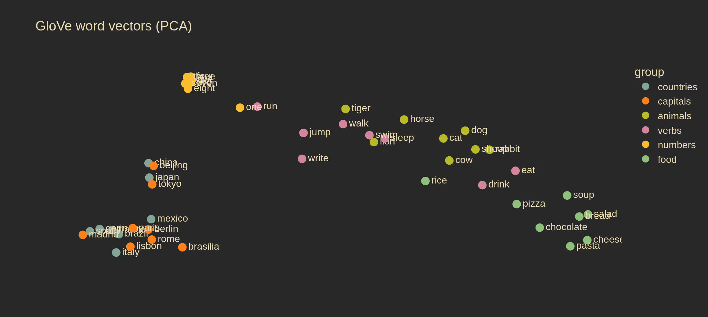
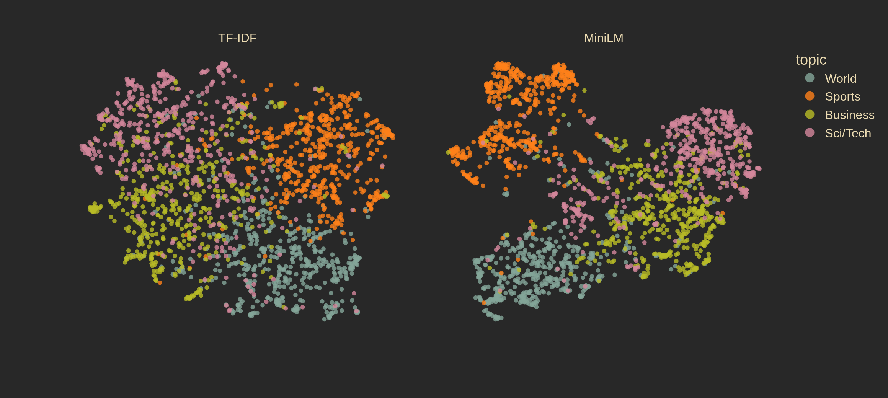
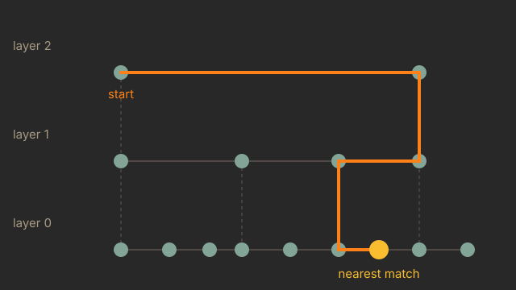

<!-- _class: lead -->

# Sequences, Tokens & Embeddings

## How text becomes numbers

Alberto Cámara · enode @ ESADE · 4 November 2026

<!-- 0:00. Introduce yourself and the series: this is session 1, attention is next. -->

---

# Computers only understand numbers

> How do we turn *"The bank raised its interest rates"* into something a model can compute with?

1. **Tokens**: cut the text into pieces
2. **Vectors**: turn each piece (or each document) into a list of numbers
   - **sparse**: one column per word, almost all zeros
   - **dense**: a few hundred numbers that capture *meaning*
3. **Use them**: similarity, search, vector databases
4. **Limitations**: why the next session is about **attention**

<!-- 1:00 -->

---

# 70 years in one slide

| Year | Milestone | Today |
|---|---|---|
| 1957 | Firth: *"You shall know a word by the company it keeps"* | dense idea |
| 1972 | Spärck Jones: inverse document frequency → **TF-IDF** | sparse |
| 2003 | Bengio et al.: neural language model with learnt word vectors | dense |
| 2013 | Mikolov et al.: **Word2Vec** | dense |
| 2014 | Pennington et al.: **GloVe** | dense, demo |
| 2016 | Sennrich et al.: **BPE** subword tokens | tokens |
| 2017 | Vaswani et al.: *Attention Is All You Need* | next session |
| 2018–19 | BERT → sentence-transformers | MiniLM, demo |

<!-- 2:30. Come back to this table at every section. -->

---

<!-- _class: divider -->

# 1. Tokens

<!-- 4:00 -->

---

# What is a token?

The unit a model reads. Three options:

| Unit | Example: *"unbelievable"* | Problem |
|---|---|---|
| **Words** | `unbelievable` | huge vocabulary; unseen words (*"unbelievableness"*, typos) break it |
| **Characters** | `u n b e l i e v a b l e` | tiny vocabulary, but sequences become very long |
| **Subwords** | `un` `believ` `able` | the middle ground: what every modern model uses |

Frequent words stay whole; rare words are built from frequent pieces.

---

# Byte Pair Encoding (BPE)

Start from characters; **repeatedly merge the most frequent adjacent pair**.

Corpus: `low` ×5, `lower` ×2, `newest` ×6, `widest` ×3

| Step | Most frequent pair | Count | New token |
|---|---|---|---|
| 1 | `e` + `s` | 6 + 3 = 9 | `es` |
| 2 | `es` + `t` | 9 | `est` |
| 3 | `l` + `o` | 5 + 2 = 7 | `lo` |
| 4 | `lo` + `w` | 7 | `low` |

Now `lowest` (never seen!) becomes `low` + `est`. Stop after *N* merges, so you choose the vocabulary size.

<!-- GPT-4o's tokenizer did ~200,000 merges. -->

---

# Demo: tokenizers

| | Words | GPT-4o | MiniLM |
|---|---|---|---|
| English | 7 | 9 | 9 |
| Spanish | 9 | 11 | **20** |

`La` `·token` `ización` `·divide` `·frases` `·increíbles` …

- MiniLM's tokenizer was trained on **English**: it shreds Spanish into tiny pieces
- More tokens = more cost, less context fits, often worse quality
- **LLMs are billed per token**

<!-- 6:00. Notebook section 1: type a sentence live, ask the audience for one. -->

---

<!-- _class: divider -->

# 2. From text to vectors

<!-- 11:00 -->

---

# Vectorization

A **vector** is just a list of numbers: an arrow or a point in space.

Goal: one vector per document (or per word) such that **similar texts → nearby vectors**.

Two families:

| | Sparse | Dense |
|---|---|---|
| Length | vocabulary size (10,000s) | fixed, small (100–1,000) |
| Mostly | zeros | non-zero |
| One number means | "how much of word *w*" | nothing on its own |
| Built by | counting | learning |

---

<!-- _class: divider -->

# Sparse vectors

<!-- 14:00 -->

---

# Bag of words

- **S1**: the cat sat on the mat
- **S2**: the dog sat on the log
- **S3**: stocks fell as the market sat still

| | as | cat | dog | fell | log | market | mat | on | sat | still | stocks | the |
|---|---|---|---|---|---|---|---|---|---|---|---|---|
| S1 | 0 | 1 | 0 | 0 | 0 | 0 | 1 | 1 | 1 | 0 | 0 | **2** |
| S2 | 0 | 0 | 1 | 0 | 1 | 0 | 0 | 1 | 1 | 0 | 0 | **2** |
| S3 | 1 | 0 | 0 | 1 | 0 | 1 | 0 | 0 | 1 | 1 | 1 | 1 |

**One-hot BoW**: 1 if the word appears, 0 if not. **Counts**: how many times.
Order is thrown away: it's a *bag*.

---

# TF-IDF: not all words are equal

*"the"* appears everywhere: it tells us nothing.

$$
\text{tf-idf}(w, d) = \underbrace{\text{count of } w \text{ in } d}_{\text{term frequency}} \times \underbrace{\log \frac{\text{number of documents}}{\text{documents containing } w}}_{\text{inverse document frequency}}
$$

| | as | cat | dog | … | on | sat | the |
|---|---|---|---|---|---|---|---|
| S1 | 0 | **0.48** | 0 | … | 0.37 | 0.28 | 0.57 |
| S3 | **0.42** | 0 | 0 | … | 0 | 0.25 | 0.25 |

Rare, distinctive words get **high** weights; everywhere-words get low ones.

---

# On a real corpus

**AG News**: news headlines in 4 topics (World, Sports, Business, Sci/Tech). We take 2,000.

| Representation | Shape | Zeros |
|---|---|---|
| One-hot BoW | 2,000 × 11,428 | 99.73% |
| BoW counts | 2,000 × 11,428 | 99.73% |
| TF-IDF (no stop words) | 2,000 × 11,176 | **99.81%** |

Each headline uses ~20 of 11,000 possible words.
That's why we call it **sparse**.

<!-- 20:00. Notebook section 2: tabs for the toy example, then the AG News sample. -->

---

# Cosine similarity

How close are two vectors? Look at the **angle** between the arrows.

$$
\cos(\mathbf{a}, \mathbf{b}) = \frac{\mathbf{a} \cdot \mathbf{b}}{\lVert \mathbf{a} \rVert \, \lVert \mathbf{b} \rVert}
$$

- **1**: same direction (same content)
- **0**: perpendicular (nothing in common)
- Length doesn't matter: a long and a short article on the same topic still score high

---

# Cosine on our toy sentences

| | S1–S2 (cat / dog) | S1–S3 (cat / stocks) |
|---|---|---|
| BoW counts | 0.75 | 0.40 |
| TF-IDF | 0.54 | 0.21 |

TF-IDF pulls apart sentences that only share *"the"* and *"sat"*. 👍

But: **cat** and **dog** are separate columns. To a sparse vector they are as different as *cat* and *stocks*. 👎

> Sparse vectors know **which words** appear, not **what they mean**.

<!-- 25:00 -->

---

<!-- _class: divider -->

# Dense vectors: words

<!-- 25:00 -->

---

# You shall know a word by the company it keeps

> *A bottle of **tezgüino** is on the table.*
> *Everybody likes **tezgüino**.*
> ***Tezgüino** makes you drunk.*
> *We make **tezgüino** out of corn.*

You've never seen the word, but you know it's an alcoholic drink.

**Distributional hypothesis**: words in similar contexts have similar meanings.

---

# Word2Vec and GloVe

Train a model on billions of words to **predict a word from its neighbours**:

> *the ___ chased the mouse* → **cat**

The model learns one vector per word as a side effect, and that vector is the **embedding**.

- Bengio (2003): first neural language model with learnt word vectors
- Word2Vec (2013): fast enough to train on all of Google News
- GloVe (2014): same idea, built from co-occurrence counts. **Our demo: 400,000 words × 100 numbers**

Same family: **one vector per word, learnt from context**.

---

# Sparse vs dense, for words

| | One-hot word | GloVe |
|---|---|---|
| Length | 400,000 | **100** |
| Non-zero entries | 1 | 100 |
| cos(*cat*, *dog*) | **0** | **0.88** |
| cos(*cat*, *mat*) | 0 | 0.16 |
| cos(*stocks*, *market*) | 0 | 0.77 |

Rhyming doesn't matter; meaning does.

<!-- 30:00. Notebook section 3: ask the audience for words. Try football, madrid, pizza. -->

---

# Vector arithmetic

| Analogy | GloVe's answer |
|---|---|
| king − man + woman | **queen** |
| paris − france + spain | **madrid** |
| walking − walk + swim | **swimming** |
| bigger − big + small | **larger** (then *smaller*) |

Directions in the space encode relations: *gender*, *capital of*, *-ing form*.
Not perfect, and it learns biases from its training text too.

---

# The word map

100 dimensions squeezed into 2 (PCA). Countries sit next to their capitals; numbers huddle together; verbs are spread out.

---

<!-- _class: divider -->

# Dense vectors: documents

<!-- 33:00 -->

---

# Sentence embeddings

Averaging word vectors is crude. Instead, a model reads the **whole text** and outputs **one vector**.

**`all-MiniLM-L6-v2`** (sentence-transformers, 2019+)
- any text → **384 numbers**
- trained so that texts with the same meaning land close together
- small (90 MB), runs on a laptop

It's a small **Transformer**, and how it works inside is next session.

---

# Sparse vs dense: 2,000 headlines

Same headlines, same colours, both squeezed to 2D with UMAP. TF-IDF: one blob with fuzzy borders. MiniLM: separate islands. (Nearest-neighbour topic accuracy: 78% vs 86%.)

<!-- Notebook section 4: hover over points, find a Sci/Tech dot among the Business ones. -->

---

# Close in meaning, zero words in common

Nearest MiniLM neighbours that share **no content words**. TF-IDF scores them **0**.

| Headline | Closest neighbour | cos |
|---|---|---|
| *Transactions BASEBALL Baltimore (AL): Signed OF B.J. Surhoff…* | *Hudson Traded to Braves ATLANTA…* | 0.55 |
| *Hurricane losses may reach $10bn…* | *Hurricanes Leave Huge Economic Footprint…* | 0.52 |
| *Deutsche Tele offers 3 bn to buy back T-Online…* | *Telefonica rejects 2 bln euro bid…* | 0.51 |
| *Just 3 of 18 candidates for president attend debate KABUL…* | *Afghan Poll Is Mostly Calm…* | 0.51 |

For a bag of words, *Hurricane* ≠ *Hurricanes* and *Kabul* has nothing to do with *Afghan*.

<!-- 40:00 -->

---

<!-- _class: divider -->

# Semantic search & vector databases

---

# Semantic search

1. Embed every document **once** → store the vectors
2. Embed the **query** with the same model
3. Return the documents with the highest cosine similarity

Query *"oil prices"* →

| Similarity | Headline |
|---|---|
| 0.72 | OPEC President Says Politics Pushing Oil Prices Higher… |
| 0.70 | Oil Holds at $47 as Iraq Resumes Exports… |
| 0.68 | Oil Falls $3, Winter Fuel Inventories Up… |

<!-- Notebook section 5: take queries from the audience. "football transfer" returns American football: the corpus is US news. -->

---

# Vector databases

Comparing against **every** vector is fine for 2,000 documents; not for 100 million.

**Approximate nearest neighbours**: trade a little accuracy for huge speed.

**HNSW**: a layered graph. Big jumps on top, then refine downwards.

**Vector databases** store vectors + metadata and index them: FAISS, pgvector, Qdrant, Chroma, Pinecone…

**RAG** (retrieval-augmented generation) = semantic search that feeds an LLM.

<!-- 43:00 -->

---

<!-- _class: divider -->

# Limitations

<!-- 43:00 -->

---

# Order is lost

| | bites | dog | man |
|---|---|---|---|
| *dog bites man* | 1 | 1 | 1 |
| *man bites dog* | 1 | 1 | 1 |

Identical vectors, very different news.

Sentences are **sequences**: order and length vary, and both matter.

---

# One word, one vector

GloVe's nearest neighbours of **bank**:

> banks, banking, credit, investment, financial, securities, lending, funds, ubs, finance

The *river bank* sense has vanished: the vector is dominated by the most frequent meaning.

---

# Context changes meaning

The vector for the token **bank** in four sentences:

**GloVe** (static)

| | river 1 | river 2 | money 1 | money 2 |
|---|---|---|---|---|
| river 1 | 1 | 1 | 1 | 1 |
| money 1 | 1 | 1 | 1 | 1 |

**MiniLM** (contextual)

| | river 1 | river 2 | money 1 | money 2 |
|---|---|---|---|---|
| river 1 | 1 | **0.82** | 0.72 | 0.65 |
| money 1 | 0.72 | 0.75 | 1 | **0.82** |

MiniLM gives **bank** a different vector depending on the words around it.

<!-- Notebook section 6. -->

---

# Next session: attention

What if each word's vector **depended on its neighbours** in the sentence?

- *bank* near *river* → riverside
- *bank* near *interest rates* → finance
- handles order and any sequence length

That's **attention**: the core of every Transformer and every LLM.

<!-- 48:00 -->

---

# Takeaways

1. Text → **tokens**: subwords (BPE) balance vocabulary size and sequence length
2. Tokens/documents → **vectors**
   - **sparse** (BoW, TF-IDF): interpretable, cheap, but blind to meaning
   - **dense** (GloVe, MiniLM): learnt, compact, similar meaning → nearby vectors
3. **Cosine similarity** measures closeness → semantic search → vector databases
4. Static vectors ignore **context** → attention

---

<!-- _class: lead -->

# Thank you! Questions?

**github.com/ber2/enode-talk**
Notebook + code to run everything on your laptop
